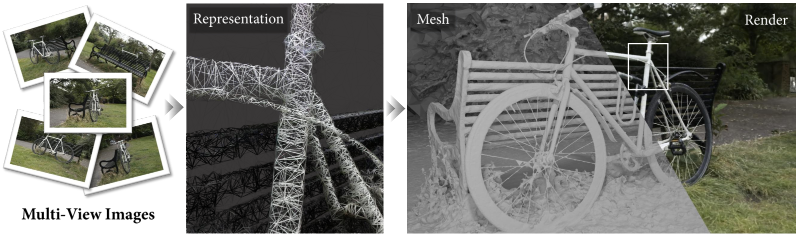

# SDFRaster

**Distance Field Rasterization for End-to-End Mesh Reconstruction**

[Project Page](https://ustc3dv.github.io/SDFRaster/) | [Paper](https://arxiv.org/abs/2604.23537)



## Abstract

Rasterization based methods have recently enabled high-quality novel view synthesis at real-time rates, but their underlying volumetric primitives do not expose a direct, globally consistent surface representation, leaving surface extraction to heuristic post-processing. In contrast, implicit signed distance field (SDF) methods provide well-defined surfaces but are typically optimized with computationally expensive ray marching. We propose **SDFRaster**, a rasterizable SDF representation that bridges this gap by combining the efficiency of rasterization with signed distance field for end-to-end mesh reconstruction. Starting from a Delaunay tetrahedralization, we optimize a continuous SDF over a tetrahedral grid and render it efficiently by rasterizing tetrahedra and alpha-compositing their contributions. We further integrate differentiable Marching Tetrahedra into the optimization loop, enabling end-to-end mesh reconstruction without post-processing mesh extraction. Experiments on DTU and Tanks and Temples demonstrate that SDFRaster achieves higher-quality and more complete surface reconstructions with lower storage cost than state-of-the-art approaches.

## Installation

The reference environment is Linux x86-64 with Python 3.11, PyTorch 2.1.0, CUDA 11.8 (with `nvcc`) and GCC/G++ 11, on an RTX 4090. You also need Python development headers, Git, `patch`, and OpenGL/EGL development libraries. For another GPU, change both architecture variables and `--cuda-arch`.

```bash
git clone https://github.com/germemoe/sdfraster.git
cd sdfraster

python3.11 -m venv .venv
source .venv/bin/activate

export CUDA_HOME=/usr/local/cuda-11.8
export PATH="$CUDA_HOME/bin:$PATH"
export CC=gcc-11 CXX=g++-11 CUDAHOSTCXX=g++-11
export TORCH_CUDA_ARCH_LIST=8.9
export TCNN_CUDA_ARCHITECTURES=89

python -m pip install setuptools==75.8.0 wheel ninja cmake==3.31.6 packaging
python -m pip install torch==2.1.0 torchvision==0.16.0 --index-url https://download.pytorch.org/whl/cu118
python -m pip install --no-build-isolation -r requirements.txt

# GPU Delaunay triangulation (gDel3D, float64, final-alive tetrahedra export)
python scripts/build_gdel3d_fp64.py --build-root .build/gdel3d --cuda-arch 89 --install
# Optional: faster exact duplicate-point check for large point clouds
python scripts/build_native.py
```

Some CUDA and Slang kernels are compiled on the first run.

## Data

### DTU

- Training data: the preprocessed DTU from [2DGS](https://github.com/hbb1/2d-gaussian-splatting) ([Google Drive](https://drive.google.com/drive/folders/1SJFgt8qhQomHX55Q4xSvYE2C6-8tFll9), [Hugging Face](https://huggingface.co/datasets/dylanebert/2DGS)). Each `scan<ID>` has `images/` (RGBA, mask in the alpha channel), `sparse/0/` and `cameras.npz`.
- Evaluation data: the official [DTU MVS ground truth](https://roboimagedata.compute.dtu.dk/?page_id=36) (`SampleSet` with `ObsMask/`, and `Points/stl/`).

```
DTU/                     DTU_Official/
├── scan24/              ├── ObsMask/
│   ├── images/          └── Points/stl/
│   ├── sparse/0/
│   └── cameras.npz
└── ...
```

### Tanks and Temples

- Training data: the [COLMAP runs released by MILo](https://drive.google.com/drive/folders/1Bf7DM2DFtQe4J63bEFLceEycNf4qTcqm) for Barn, Caterpillar, Courthouse, Ignatius, Meetingroom and Truck.
- Evaluation data: ground-truth point clouds, camera trajectories, alignments and crop files from the [official Tanks and Temples download page](https://www.tanksandtemples.org/download/).

```
TNT/                     GT_TNT/
├── Barn/                ├── Barn/
│   ├── images/          │   ├── Barn.ply
│   └── sparse/0/        │   ├── Barn.json
└── ...                  │   ├── Barn_COLMAP_SfM.log
                         │   └── Barn_trans.txt
                         └── ...
```

## Training

```bash
# DTU, one scene (the per-scene SDF densification ratio is read from configs/dtu_sdf_densify_ratios.json)
python dtu.py train --data /data/DTU/scan24 --out runs/dtu/scan24

# TNT, one scene (indoor/outdoor preset is chosen from the scene name)
python tnt.py train --data /data/TNT/Barn --out runs/tnt/Barn
```

All six TNT scenes:

```bash
for scene in Barn Caterpillar Courthouse Ignatius Meetingroom Truck; do
  python tnt.py train --data /data/TNT/$scene --out runs/tnt/$scene
done
```

`train.py` can also be called directly with any config, and every config key can be overridden on the command line, for example `python train.py --config configs/tnt_outdoor.json --dataset_path /data/TNT/Barn --output_path runs/barn --seed 54`.

## Evaluation

```bash
# DTU: exports mesh_mt.ply and mesh_tsdf.ply, scores the TSDF mesh
python dtu.py eval --checkpoint runs/dtu/scan24 --gt /data/DTU_Official

# TNT: exports the raw MT mesh and scores it with the legacy TNT protocol
python tnt.py eval --checkpoint runs/tnt/Barn --gt /data/GT_TNT/Barn
```

Results go to `<checkpoint>/eval/metrics.json` (DTU) and `<checkpoint>/eval_tnt/metrics.json` (TNT). The TNT evaluator in `eval/tnt_milo/` is the legacy Tanks and Temples toolbox as packaged by MILo: the training trajectory is registered to the official COLMAP log, the mesh is cropped and refined with ICP, and precision/recall are computed at the official per-scene threshold. The MT mesh is scored as extracted, without culling or subdivision.

## Configurations

| File | Used for | Key settings |
|---|---|---|
| `configs/dtu_18k.json` | DTU | 18k steps, rendered mesh normals, SDF densification, Eikonal 1e-3, 1M vertices |
| `configs/tnt_outdoor.json` | Barn, Caterpillar, Courthouse, Ignatius, Truck | mesh-normal weight 0.25, mesh-depth weight 0 |
| `configs/tnt_indoor.json` | Meetingroom | mesh-normal weight 0, mesh-depth weight 0 |

The two TNT presets are otherwise identical: 18k steps, seed 53, 3M vertex budget with up to 250k new vertices per densification before step 6000 and 50k afterwards, normal-depth consistency on the median depth (weight 0.05, linear warm-up from step 2000 to 5001), no Eikonal term and no geometry culling.

TNT-specific training options in `train.py` default to off, so the DTU preset trains exactly as before:

| Option | Effect |
|---|---|
| `normal_depth_med_warmup_end` | Linear warm-up of the median-depth normal loss from `normal_depth_start` to this step |
| `split_cap_change_step`, `max_split_per_iter_after` | Lower the per-densification vertex cap from this step on |
| `densify_render_min_t` | Near limit of the error renders that drive densification |
| `compact_tile_sort` | In-place CUB tile sort with lower peak memory (same order) |

## Repository structure

```
train.py                 training loop
dtu.py / tnt.py          dataset front ends (train, eval)
configs/                 DTU and TNT presets
models/ data/ utils/     model, data loading, losses, densification, mesh tools
delaunay_rasterization/  Slang/CUDA tetrahedra rasterizer
eval/dtu/                DTU Chamfer evaluation
eval/tnt_milo/           legacy Tanks and Temples evaluation (from MILo)
scripts/                 mesh extraction (MT, TSDF) and native builds
third_party/gdel3d/      gDel3D sources; patches/ holds the float64 and alive-export patches
native/                  exact duplicate-point counter
```

## Acknowledgements

This code builds on [Radiance Meshes](https://half-potato.gitlab.io/rm/) and its GPU Delaunay bindings ([pyGDel3D](https://github.com/half-potato/pyGDel3D), based on [gDel3D](https://github.com/ashwin/gDel3D)). We use the TNT COLMAP data and evaluation packaging of [MILo](https://github.com/Anttwo/MILo), the preprocessed DTU data of [2DGS](https://github.com/hbb1/2d-gaussian-splatting), and evaluation code adapted from [2DGS](https://github.com/hbb1/2d-gaussian-splatting), [GOF](https://github.com/autonomousvision/gaussian-opacity-fields) and the [Tanks and Temples toolbox](https://github.com/isl-org/TanksAndTemples). We thank the authors for releasing their code and data.

## Citation

```bibtex
@inproceedings{cui2026sdfraster,
  title     = {Distance Field Rasterization for End-to-End Mesh Reconstruction},
  author    = {Cui, Jinkai and Song, Kaiwen and Niu, Chumeng and Zhang, Juyong},
  booktitle = {ACM SIGGRAPH 2026 Conference Papers},
  year      = {2026}
}
```
